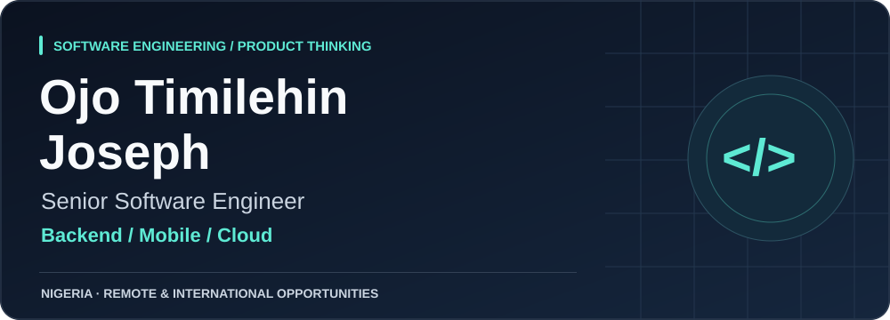
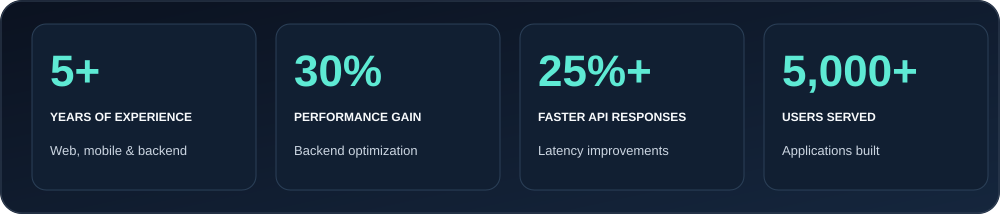
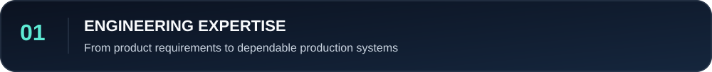
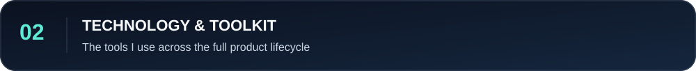
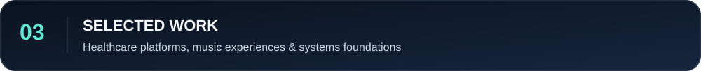
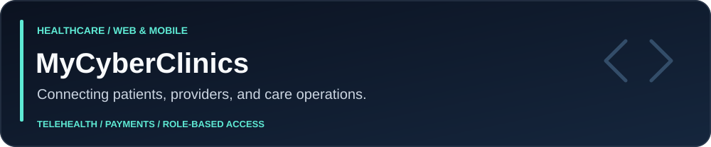
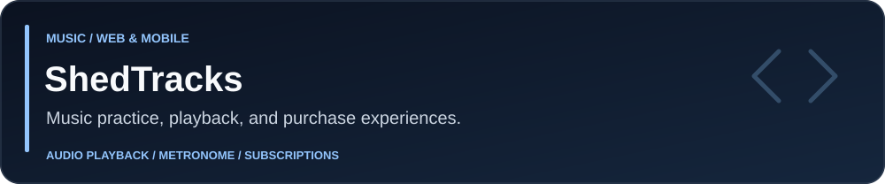
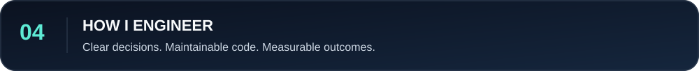
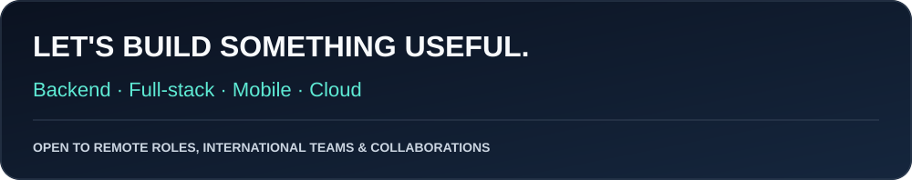

  

<h1 align="center">Ojo Timilehin Joseph</h1>

<strong>Reliable systems. Thoughtful experiences. Software with purpose.</strong>

  
  
  

  <a href="#about-me">About</a> &nbsp; / &nbsp;
  <a href="#engineering-expertise">Expertise</a> &nbsp; / &nbsp;
  <a href="#technology--tools">Technology</a> &nbsp; / &nbsp;
  <a href="#selected-work">Projects</a> &nbsp; / &nbsp;
  <a href="#lets-connect">Connect</a>

## About me

I'm a **Senior Software Engineer with 5+ years of experience** building web applications, cross-platform mobile products, and dependable backend services. My core stack is **TypeScript, Node.js, React, and React Native**, with cloud experience across **AWS, Microsoft Azure, and Google Cloud**.

My work spans **healthcare, payments, subscriptions, and music applications**. With a background in **Business Administration**, I connect engineering decisions to user needs and business outcomes, from the first interface to deployment and ongoing support.

<strong>Impact in detail</strong>

- Improved application performance by **30%** through backend optimization.
- Reduced API response times by **25%+**.
- Built applications serving **5,000+ users**.
- Designed scalable APIs handling **10,000+ requests**.

## Engineering expertise

<table>
  <tr>
    <td width="50%" valign="top"><h3>Backend & architecture</h3>
REST APIs, modular services, background jobs, webhook processing, caching, and database optimization.
</td>
    <td width="50%" valign="top"><h3>Web & mobile products</h3>
Responsive React applications, React Native and Expo, accessible interfaces, state management, and complete product flows.
</td>
  </tr>
  <tr>
    <td valign="top"><h3>Cloud & delivery</h3>
Containerized applications, cloud deployment, automated delivery, secrets management, and release validation.
</td>
    <td valign="top"><h3>Reliability & security</h3>
Authentication, role-based access, input validation, payment verification, idempotency, retries, and observability.
</td>
  </tr>
</table>

## Technology & tools

### Languages & foundations

  
  
  
  
  
  
  
  
  

### Frontend & mobile

  
  
  
  
  
  
  
  
  
  
  
  
  
  
  
  

### Backend & asynchronous systems

  
  
  
  
  
  
  
  

### Databases & storage

  
  
  
  
  
  
  
  

### Cloud, infrastructure & delivery

  
  
  
  
  
  
  
  
  
  
  
  
  

### Payments & communication

  
  
  
  
  
  
  

### AI & content

  
  

### Testing, quality & observability

  
  
  
  
  
  
  
  
  
  
  

## Selected work

### MyCyberClinics

- **Patient experience:** Onboarding, appointment booking, consultations, and health records across web and mobile.
- **Platform services:** Payments, subscriptions, transactional notifications, and administrative operations.
- **Reliability:** Payment verification, background reconciliation, access control, and backend performance improvements.

  
  
  
  
  
  
  
  

### ShedTracks

- **Playback experience:** Responsive player interfaces, accessible controls, and mobile tempo adjustments.
- **Mobile reliability:** Work on the iOS background audio lifecycle and playback continuity.
- **Commerce:** Catalog browsing, store, subscription, and payment workflows with focused regression testing.

  
  
  
  
  
  
  
  

<strong>Explore my systems and web foundations</strong>

| Project | Focus | Technology |
| :--- | :--- | :--- |
| [System Engineering & DevOps](https://github.com/Timex19/alx-system_engineering-devops) | System engineering coursework and command-line tooling | Shell |
| [Simple Shell](https://github.com/Timex19/simple_shell) | A command-line interpreter | C |
| [Responsive Restaurant Website](https://github.com/Timex19/Restaurant_Website) | Responsive frontend development | HTML, CSS, JavaScript |

## Engineering approach

| Understand | Build | Validate | Deliver |
| :--- | :--- | :--- | :--- |
| Connect requirements to user needs and business outcomes. | Use clear boundaries, strong typing, and established patterns. | Test behavior, measure performance, and plan recovery paths. | Consider deployment, monitoring, and ongoing support. |

<strong>GitHub activity</strong>

  

Public GitHub activity represents part of my work; professional projects also include private repositories.

## Let's connect

<strong>Open to remote and international roles, meaningful products, and engineering collaborations.</strong>

  
  

